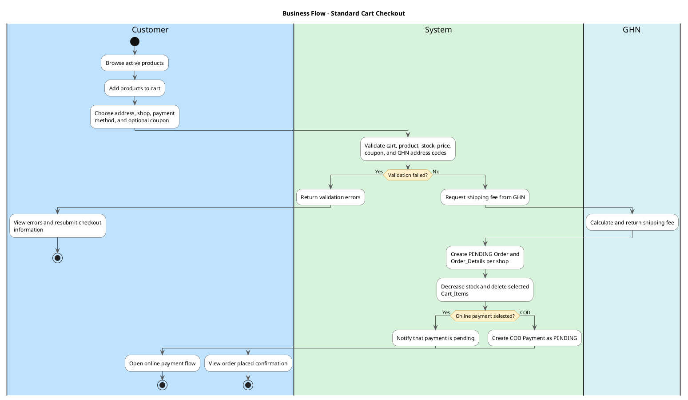
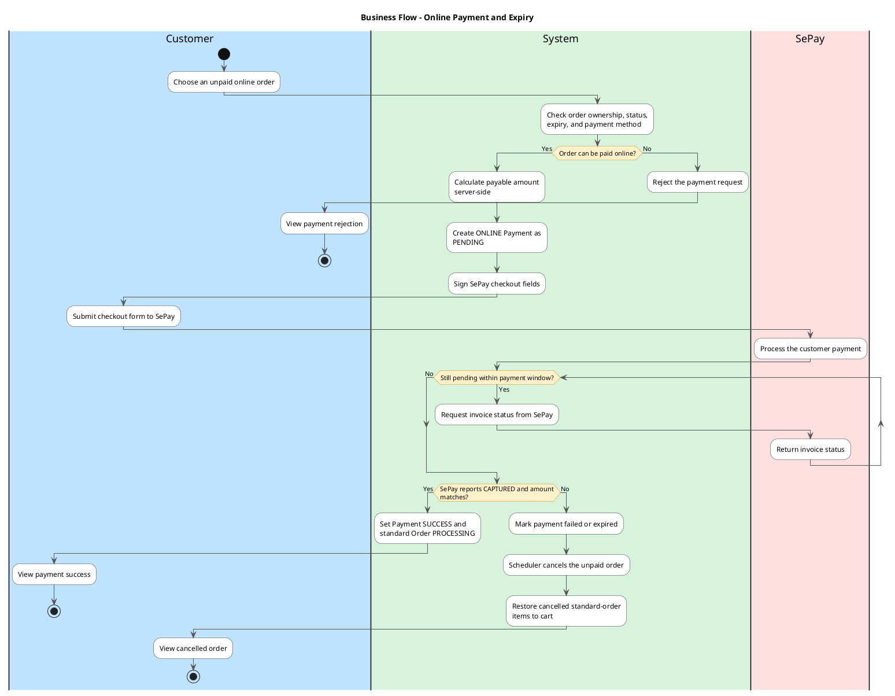
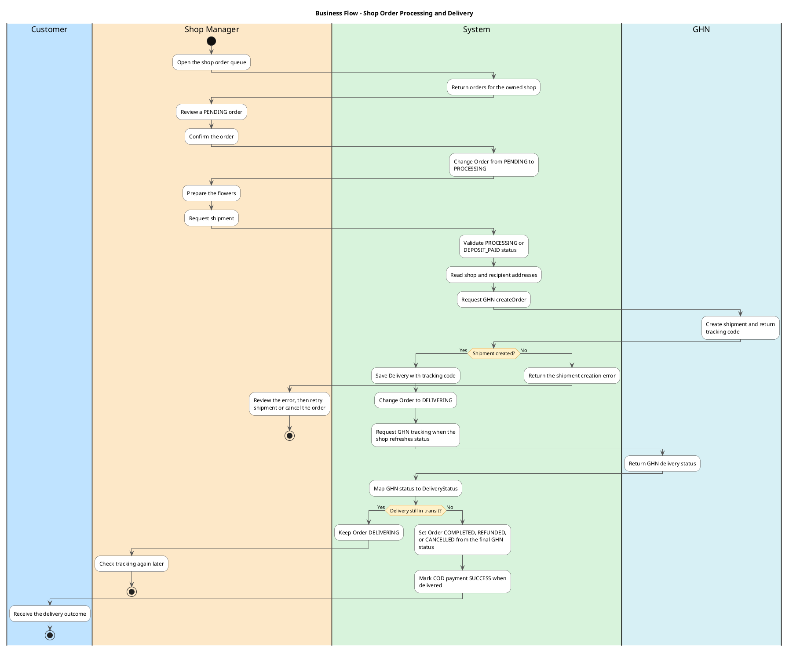
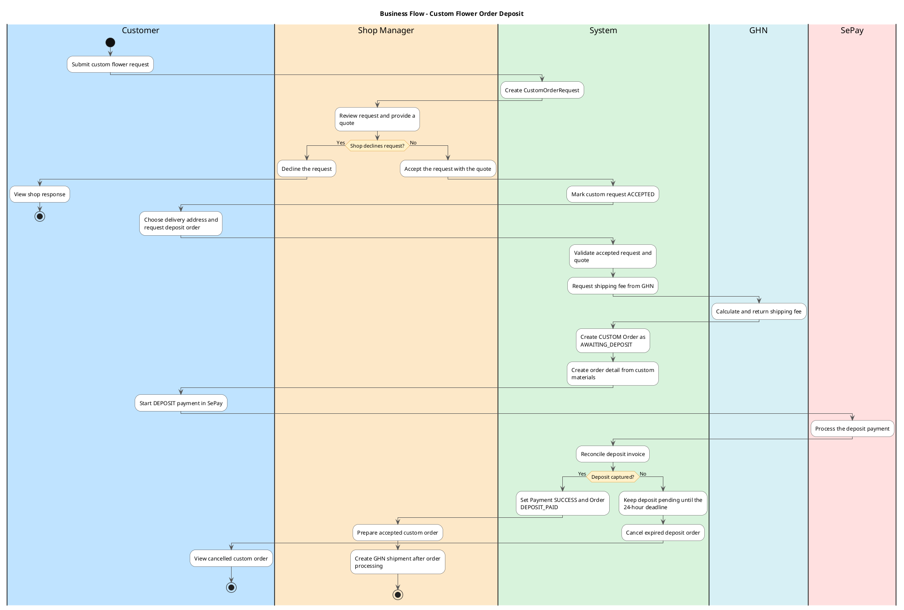
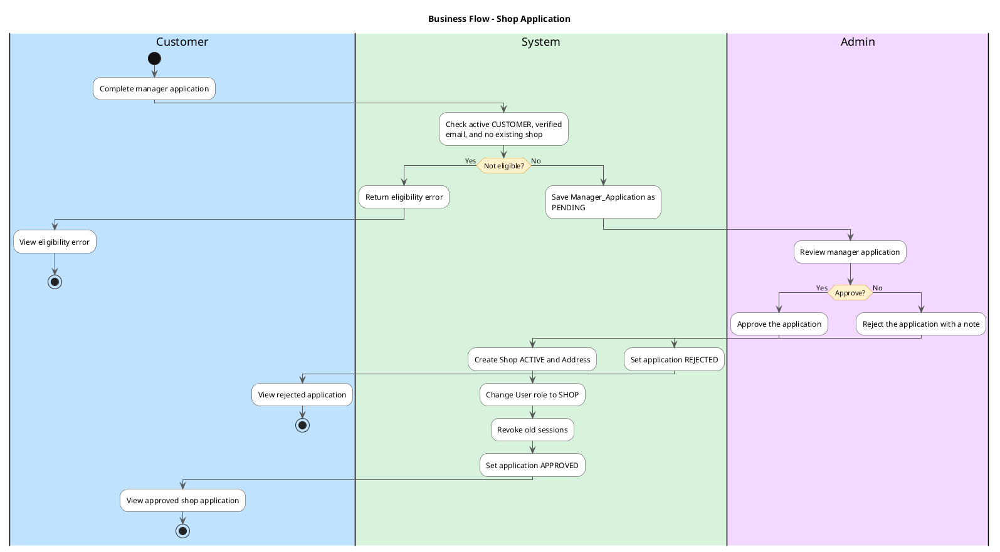
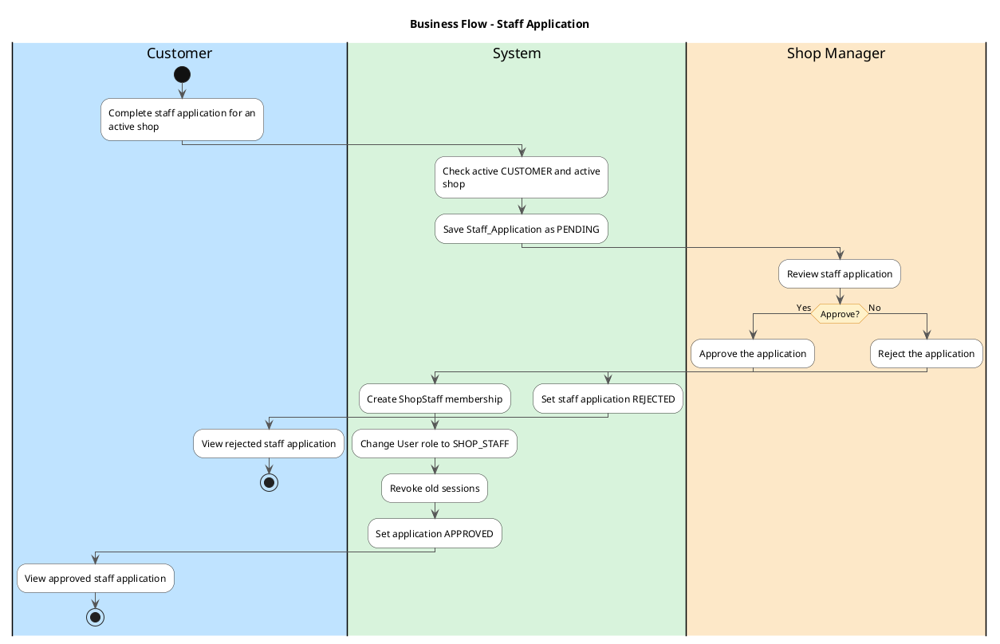
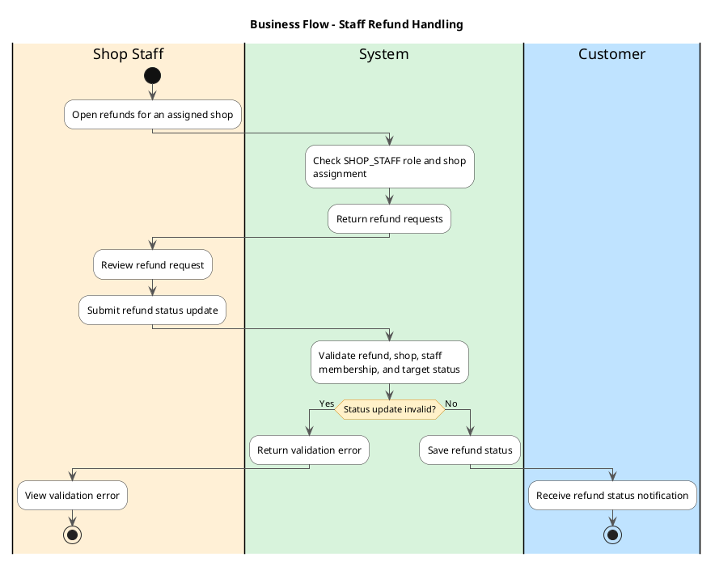
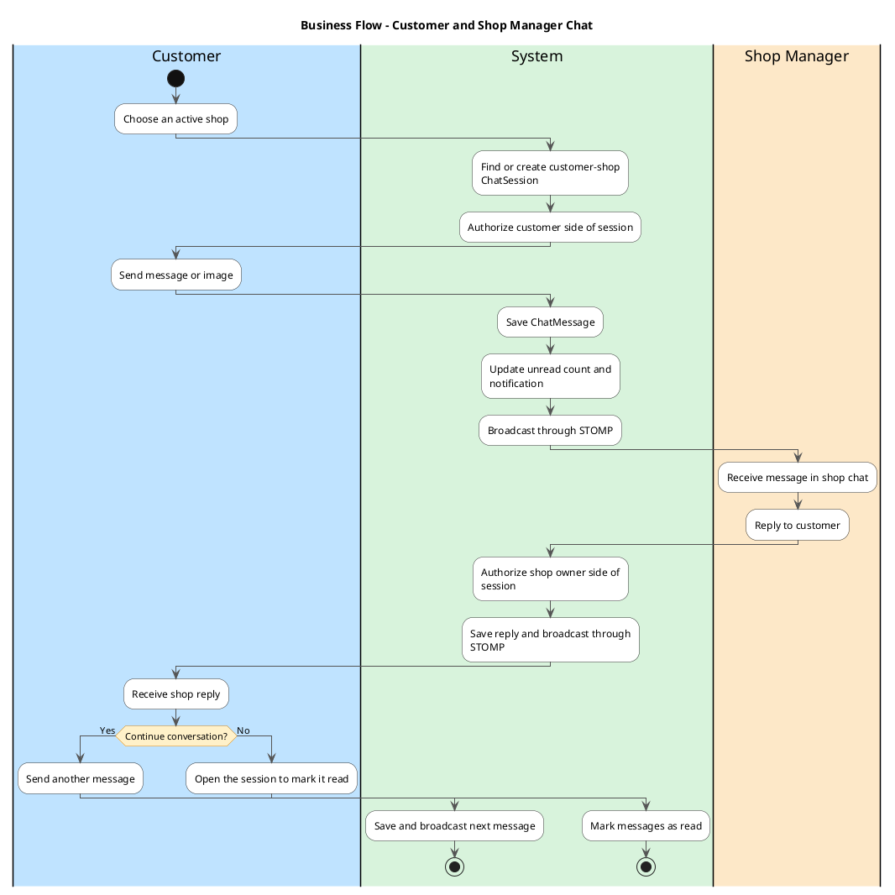

# FlowerShop UML Swimlane Diagrams

These UML activity diagrams are aligned with the implemented controllers,
services, status transitions, and integrations. The lanes are business actors
or the FlowerShop system. GHN and SePay are external systems, so each has its own
lane and the FlowerShop System lane calls them explicitly.

Open the diagrams in VS Code with a PlantUML extension and press `Alt+D`.

Layout rules used in every diagram:

- Both branches of a decision start with an action in the lane that holds the
  diamond, so no branch line crosses a lane border at the diamond. Each `else`
  re-declares that lane, otherwise PlantUML continues in the previous branch's lane.
- Every decision branch carries a label and an action. There are no empty
  diamonds.
- Each path ends in its own final node, so branches never merge into a blank
  diamond.
- Loops use a labelled `repeat` decision inside a single lane.

## 1. Standard Cart Checkout

Source flow: `POST /api/orders/{userId}/batch` in `OrderController` and
`OrderService.makeOrders`.

## 2. Online Payment and Payment Expiry

Source flow: `PaymentController`, `SePayGatewayService`, and
`PaymentTimeoutScheduler`.

## 3. Shop Manager Order Processing and GHN Delivery

Source flow: `ManagerOrderController`, `ManagerOrderService`, `GhnService`,
and `DeliverySync`.

## 4. Custom Flower Order and Deposit

Source flow: `CustomFlowerOrderController`, `OrderController`,
`OrderService.makeCustomOrder`, and `SePayGatewayService`.

## 5. Manager Shop Application

Source flow: `ManagerApplicationService`.

## 6. Staff Application

Source flow: `StaffApplicationService`.

## 7. Staff Refund Handling

Source flow: `StaffRefundController` and `StaffRefundService`. Staff can list
refunds for an assigned shop and update refund status; staff do not confirm
orders, create GHN shipments, or operate chat in the current code.

## 8. Customer and Shop Manager Chat

Source flow: `CustomerChatController`, `ManagerChatController`, and
`ChatService`. Shop staff has no chat endpoint in the current implementation.

