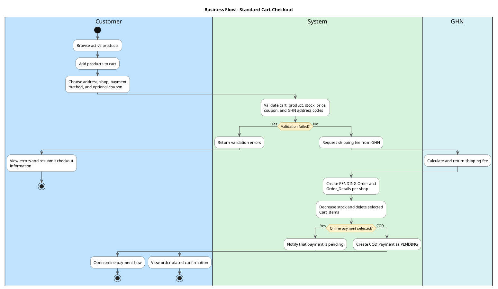
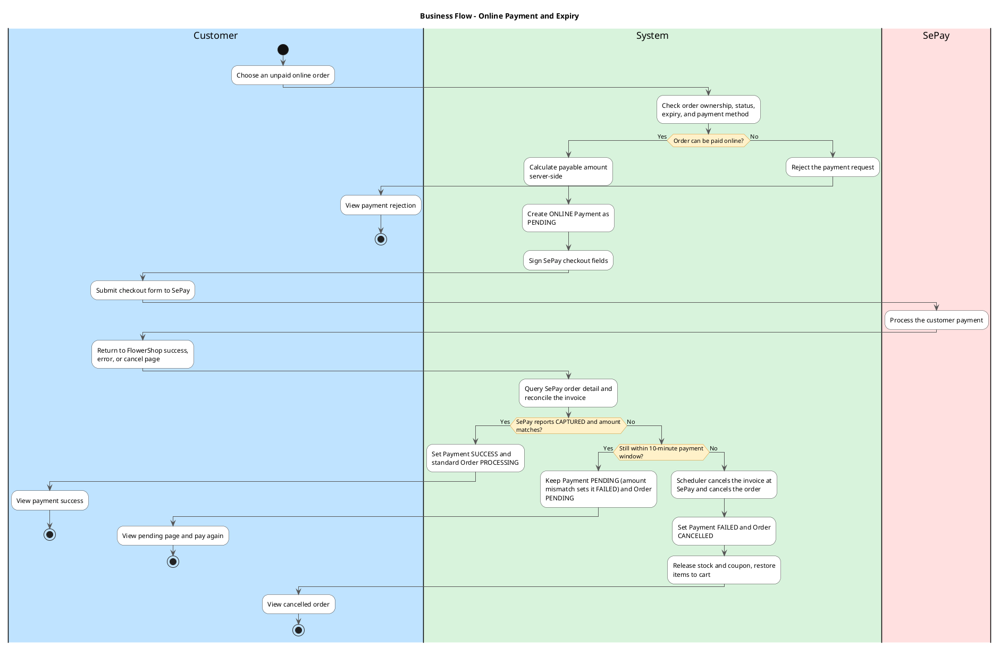
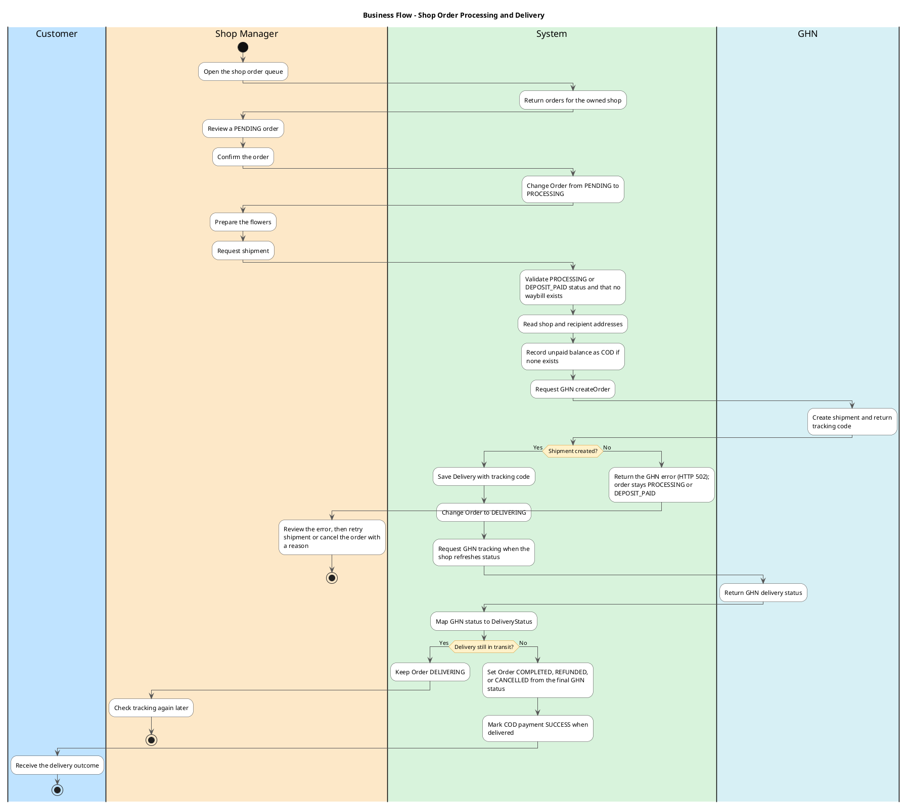
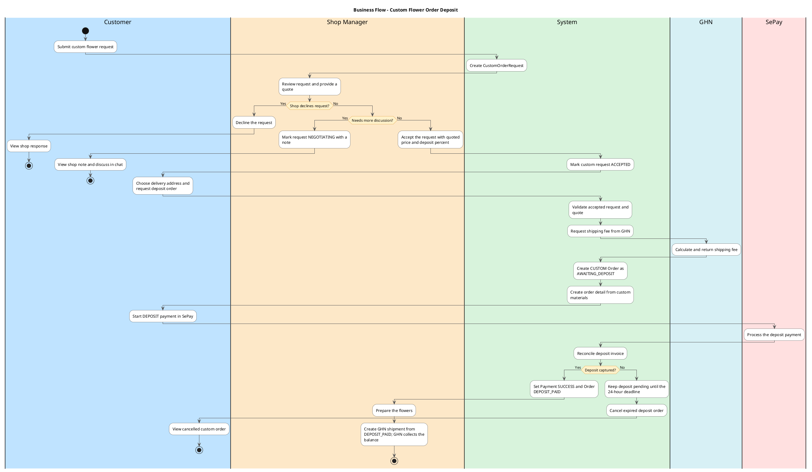
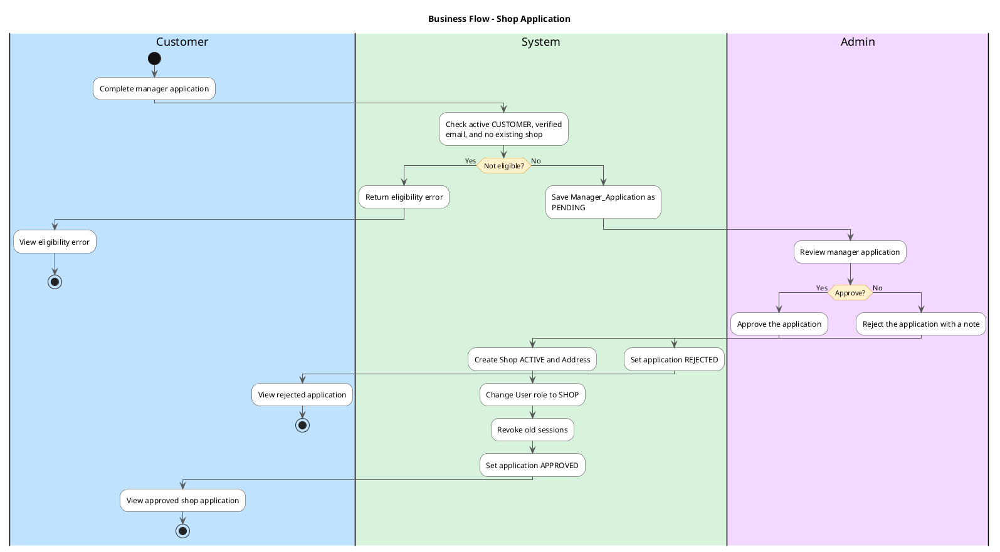
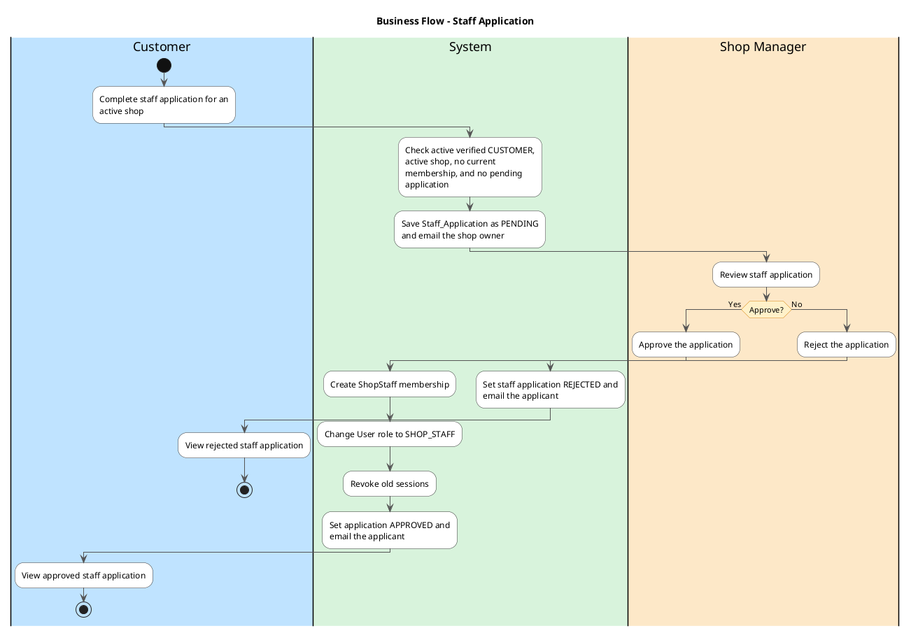
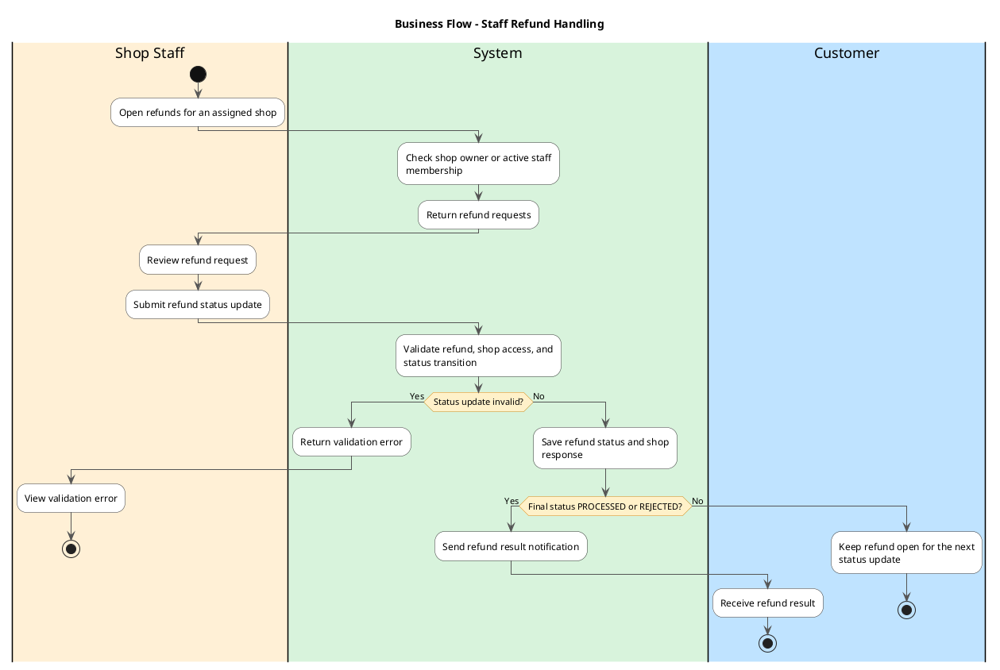
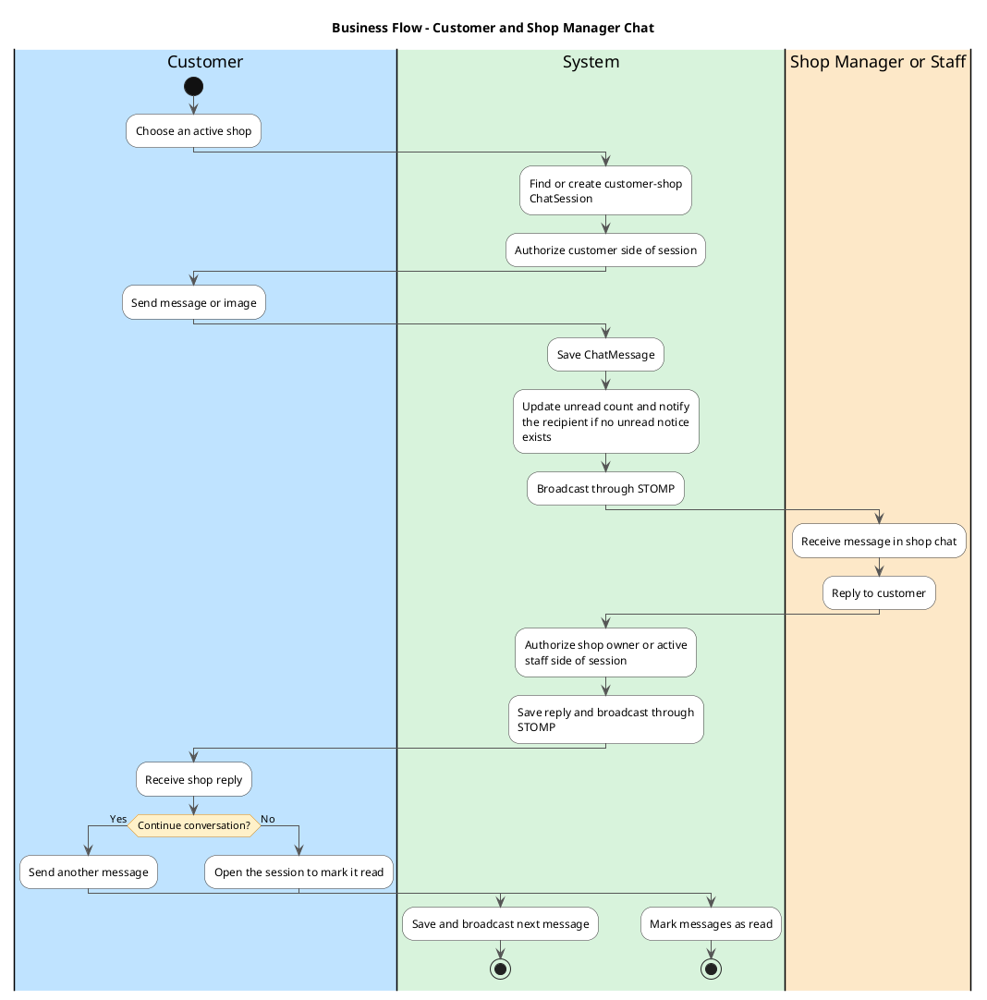

# FlowerShop UML Swimlane Diagrams

These UML activity diagrams are aligned with the implemented controllers,
services, status transitions, and integrations. The lanes are business actors
or the FlowerShop system. GHN and SePay are external systems, so each has its own
lane and the FlowerShop System lane calls them explicitly.

Open the diagrams in VS Code with a PlantUML extension and press `Alt+D`.

Layout rules used in every diagram:

- Both branches of a decision start with an action in the lane that holds the
  diamond, so no branch line crosses a lane border at the diamond. Each `else`
  re-declares that lane, otherwise PlantUML continues in the previous branch's lane.
- Every decision branch carries a label and an action. There are no empty
  diamonds.
- Each path ends in its own final node, so branches never merge into a blank
  diamond.
- Loops use a labelled `repeat` decision inside a single lane.

## 1. Standard Cart Checkout

Source flow: `POST /api/orders/{userId}/batch` in `OrderController` and
`OrderService.makeOrders`.

## 2. Online Payment and Payment Expiry

Source flow: `PaymentController`, `SePayGatewayService`, and
`PaymentTimeoutScheduler`. `PaymentReturnController` sends the customer back to
the frontend `/payment/{success|error|cancel}` page. SePay has no webhook: the
system asks SePay when the customer returns or polls status, and the scheduler
(every 5 seconds) cancels standard orders still unpaid 10 minutes after creation.

## 3. Shop Manager Order Processing and GHN Delivery

Source flow: `ManagerOrderController`, `ManagerOrderService`, `GhnService`,
and `DeliverySync`. Active shop staff use the same endpoints as the owner. GHN has
no webhook: a waybill status changes only when the shop refreshes it, when a
customer opens a DELIVERING order, or when the daily `MaintenanceJob` (02:00)
completes a DELIVERED order that has no refund and was delivered at least 3 days
earlier.

## 4. Custom Flower Order and Deposit

Source flow: `CustomFlowerOrderController`, `OrderController`,
`OrderService.makeCustomOrder`, and `SePayGatewayService`. Orders quoted on an
existing custom order (`AWAITING_QUOTE` to `QUOTED`) use
`CustomOrderWorkflowService.accept`, where the customer chooses FULL or DEPOSIT.
DEPOSIT requires ONLINE payment, its errors return HTTP 409, and the deposit comes
from `CustomOrderPricing.deposit`.

## 5. Manager Shop Application

Source flow: `ManagerApplicationService`. A REJECTED application can be submitted
again. Admin decisions must include a `note` field, which may be blank.

## 6. Staff Application

Source flow: `StaffApplicationService`. Only the shop owner can review, and the
owner's review screen (`StaffApplicationsView`) is currently not mounted in the
UI, so reviews go through the API only. Shop staff cannot review applications.

## 7. Staff Refund Handling

Source flow: `StaffRefundController` and `StaffRefundService`. The shop owner or an
active staff member can list refunds for the shop and update refund status.
Allowed moves: REQUESTED to APPROVED or REJECTED, and APPROVED to PROCESSED or
REJECTED; other moves return HTTP 400. Only PROCESSED and REJECTED notify the
customer. Active shop staff can also confirm orders and create GHN shipments
(section 3) and use shop chat (section 8).

## 8. Customer and Shop Manager Chat

Source flow: `CustomerChatController`, `ManagerChatController`, and
`ChatService`. Active shop staff use the same shop chat endpoints as the owner.

