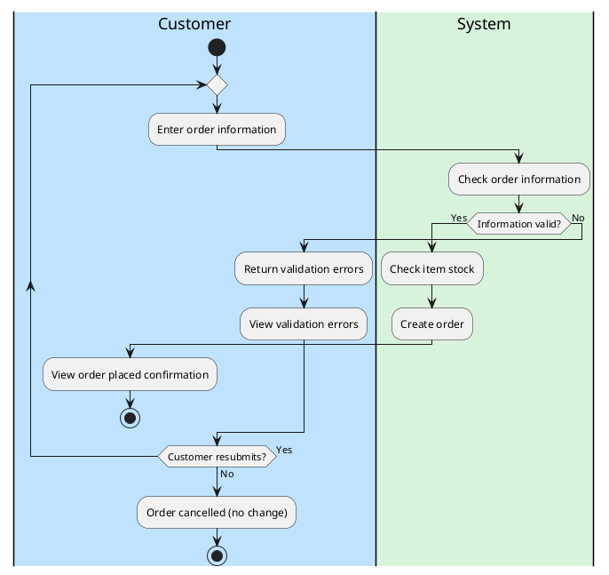

# Spec: Swimlane "Business Flow – Order" (tham chiếu phong cách)

Tài liệu mô tả một ảnh swimlane mẫu để AI khác (Codex) vẽ lại các sơ đồ trong
`SWIMLANES.md` theo cùng phong cách và cấu trúc. Ảnh gốc là UML Activity Diagram
dạng swimlane dọc. Các action không đánh mã ID hay tiền tố.

## 1. Bố cục tổng thể

- Tiêu đề trong một khung bo góc ở trên cùng: `Business Flow – Order (Swimlane Diagram)`.
- 5 lane dọc (ảnh mẫu), chạy ngang từ trái sang phải, mỗi lane là một tác nhân:
  `Customer | System | Shop | Payment | Delivery`. Bộ lane của `SWIMLANES.md` khác, xem mục 1.1.
- Luồng chính đi từ trên xuống dưới. Các mũi tên chéo lane đi ngang qua ranh giới lane.
- Mỗi lane có header riêng, nền lane là màu pastel nhạt cùng tông với header.

| Lane | Màu header / nền | Vai trò |
|---|---|---|
| Customer | xanh dương | Duyệt, đặt hàng, nhận thông báo, quyết định sửa đơn hoặc thử lại thanh toán |
| System | xanh lá | Validate, kiểm tra kho, tạo đơn, tạo yêu cầu thanh toán, cập nhật trạng thái |
| Shop | cam | Kiểm tra nguyên liệu, xác nhận đơn custom, đóng gói, báo sẵn sàng |
| Payment | tím | Xử lý và ghi nhận thanh toán |
| Delivery | xanh ngọc (teal) | Nhận hàng, giao, xử lý giao thất bại hoặc hoàn trả |

### 1.1 Áp dụng cho `SWIMLANES.md`

Khi vẽ lại sơ đồ trong `SWIMLANES.md`, dùng đúng tên lane và mã màu của file đó:

| Lane trong `SWIMLANES.md` | Màu header/nền | Lane tương ứng ảnh mẫu |
|---|---|---|
| Customer | `#BFE3FF` | Customer |
| System | `#D8F3DC` | System |
| Shop Manager | `#FDE8C8` | Shop |
| SePay | `#FFE0E0` | Payment |
| GHN | `#D7F0F5` | Delivery |
| Admin | `#F3D9FF` | (không có) |
| Shop Staff | `#FFF0D6` | (không có) |

Màu tên gợi ý trong bảng mục 1 chỉ mang tính minh họa; khi vẽ `SWIMLANES.md` dùng mã hex ở bảng này. `SWIMLANES.md` có 8 sơ đồ, mỗi sơ đồ chỉ dùng một tập lane con của bảng trên.

## 2. Ký hiệu node

| Ký hiệu | Hình dạng | Ghi chú |
|---|---|---|
| Initial node | Chấm tròn đen đặc, nhãn `Start` | Duy nhất, ở lane Customer |
| Action | Hình chữ nhật bo tròn, nền và viền theo màu lane | Chỉ có nhãn mô tả, không có mã ID |
| Decision | Hình thoi, nền cùng tông lane | Mỗi cạnh ra có guard `Yes` hoặc `No` |
| Final node | Hình tròn có vòng ngoài (bullseye) kèm nhãn kết quả | Có nhiều final node, mỗi cái là một kết cục khác nhau |

## 3. Quy ước đường nối

- Connector vuông góc (orthogonal), có mũi tên đầu. Không dùng đường cong.
- Guard condition ghi nhãn `Yes` / `No` cạnh mũi tên ra khỏi decision.
- Đường quay lại (loop) đi vòng sang trái hoặc phải rồi nối vào node đích phía trước.
- Một mũi tên đậm hơn dùng để nhấn mạnh bước chuyển trạng thái chính.
- Mọi action đều có ít nhất một cạnh vào và một cạnh ra, trừ final node.

## 4. Luồng nghiệp vụ trong ảnh

1. **Customer**: Start → Browse & view product details → Add to cart → Enter order information.
2. **System** Check order information (Validate data) → decision **Information valid?**
   - No → quay lại Enter order information.
   - Yes → decision **Order type?**
3. **Order type = Ready-made**: Check item stock → decision **Item in stock?**
   - No → Customer nhận Receive notification → decision **Revise order?**
     - Yes → quay lại Enter order information.
     - No → final **Order cancelled (Out of stock / No change)**.
   - Yes → Create order.
4. **Order type = Custom-made**: Check raw materials → (Shop) decision **Enough materials?**
   - No → Reject / request clarification → Confirm custom order.
   - Yes → Confirm custom order → Create order.
5. Create order → Create payment request → **Payment** Process payment
   (Card / Wallet / COD) → decision **Payment successful?**
   - No → Customer Receive payment result (failed) → decision **Retry payment?**
     - Yes → quay lại bước thanh toán.
     - No → final **Order cancelled (Payment failed)**.
   - Yes → Record payment result (success) → Order status: Paid (Notify shop to prepare).
6. **Shop**: Prepare / pack goods → Update status: Ready.
7. **System** Order status: Prepared (Notify delivery & customer) →
   Customer Receive payment success & order-ready notice, đồng thời giao cho Delivery.
8. **Delivery** Receive from shop & deliver goods → decision **Delivery successful?**
   - Yes → Delivery status: Delivered (Update order status) →
     Customer Receive delivery result → final **Order completed**.
   - No → decision **Retry delivery?**
     - Yes → quay lại Receive from shop & deliver goods.
     - No → Handle return / failed order (Refund / Exchange) → final **Order returned (Refund / Exchange)**.

### Khác với hệ thống thực (đối chiếu code)

Luồng trên mô tả ảnh mẫu. Hệ thống thực khác ở các điểm sau:

- Trạng thái đơn (`entity/enums/OrderStatus.java:4-5`): PENDING, AWAITING_DEPOSIT, DEPOSIT_PAID, PROCESSING, DELIVERING, COMPLETED, CANCELLED, REFUNDED, AWAITING_QUOTE, QUOTED. Không có Paid, Ready hay Prepared.
- Thanh toán (`entity/enums/PaymentMethod.java:4`): chỉ ONLINE (qua SePay) hoặc COD. Không có Card hay Wallet.
- Shop xác nhận đơn: PENDING → PROCESSING (`ManagerOrderService.java:177`); tạo vận đơn GHN: → DELIVERING (`ManagerOrderService.java:259`). Không có bước "Update status: Ready".
- Thanh toán SePay thành công: đơn thường chuyển thẳng sang PROCESSING, đơn cọc sang DEPOSIT_PAID (`SePayGatewayService.java:565-568`).
- Đơn hoa theo yêu cầu đi theo vòng AWAITING_QUOTE → QUOTED → AWAITING_DEPOSIT → DEPOSIT_PAID → PROCESSING (`CustomOrderWorkflowService.java:83, 131, 156`), không phải nhánh "Order type = Custom-made" trong checkout thường.
- Đơn chưa thanh toán bị hủy tự động: PENDING sau 10 phút, AWAITING_DEPOSIT sau 24 giờ (`OrderService.java:479-486`). Chưa xác minh nhánh "Retry payment?" trong code.
- GHN không gọi lại hệ thống. Trạng thái giao hàng đổi khi shop hoặc khách bấm đồng bộ. GHN `delivered` → COMPLETED, `returned` → REFUNDED, `cancel` → CANCELLED (`DeliverySync.java:28-44`). Không có nhánh Exchange.

## 5. Đặc điểm cần giữ khi vẽ lại

- Mỗi action nằm đúng lane của tác nhân thực hiện nó, không đặt tùy ý.
- Có đủ các cấu trúc điều khiển: decision, loop (nhập lại, thử lại), nhiều nhánh kết thúc.
- Mỗi kết cục (thành công, hủy, trả hàng) có final node và nhãn riêng.
- Có bước thông báo giữa System và Customer, hiển thị rõ là mũi tên chéo lane.
- Màu theo lane nhất quán, chữ ngắn gọn, mỗi node một ý.
- Customer đứng đầu; các lane còn lại theo thứ tự xuất hiện trong luồng. `SWIMLANES.md`
  không dùng một thứ tự chung (sơ đồ 3 đặt Shop Manager trước System).
- Áp dụng layout rules ở đầu `SWIMLANES.md`: mỗi nhánh của decision bắt đầu bằng một action
  trong lane chứa thoi; mỗi `else` khai báo lại lane; không có thoi rỗng; mỗi đường kết thúc
  bằng final node riêng; vòng lặp dùng `repeat` có nhãn trong một lane.

## 6. Các điểm chưa rõ trong ảnh

- Mũi tên "Retry payment? Yes" có vẻ trỏ về vùng Shop; hợp lý nhất về nghiệp vụ
  là quay lại Process payment.
- Check raw materials nằm sát ranh giới System và Shop; ở đây xếp vào Shop.
- Thứ tự "Order status: Prepared" so với việc Delivery nhận hàng chưa được vẽ rõ.

## 7. Ánh xạ sang PlantUML

Snippet trên đã biên dịch được bằng PlantUML (`-checkonly` và `-tpng`) và có đủ các
cấu trúc: hai nhánh đều bắt đầu bằng action, nhánh `No` quay lại nhập liệu, một final node
cho đơn thành công và một cho hủy. Màu lấy từ bảng mục 1.1.

Quy tắc: `|#màu|Lane|` đặt lane, `if/else` là decision có guard, `repeat/while`
là loop, `start`/`stop` là initial/final. Với nhiều final node, dùng `stop` hoặc
`end` ở mỗi nhánh kèm một action nhãn trước đó, ví dụ `:Order cancelled;`.
Snippet phải tuân theo layout rules ở đầu `SWIMLANES.md` (mục 5).
