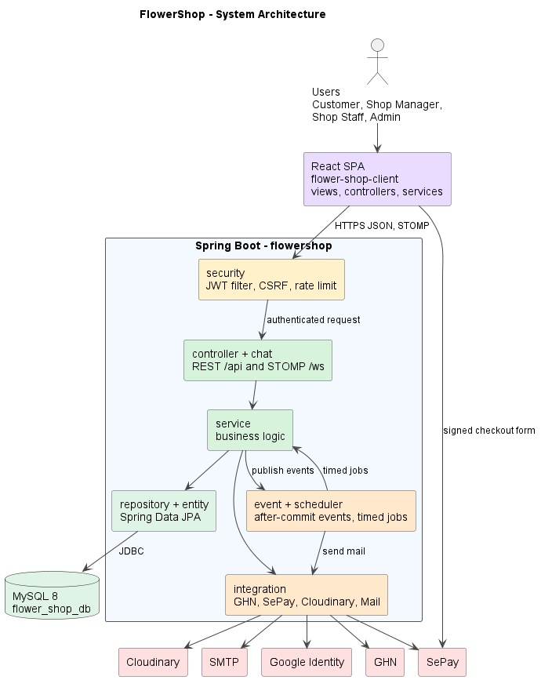

# FlowerShop architecture

Source: [architecture.puml](architecture.puml). Render with the VS Code PlantUML
extension (`Alt+D`) or `java -jar plantuml.jar -tpng architecture.puml`.

## Packages and how they interact

| Package | Role | Calls |
|---|---|---|
| React SPA (`flower-shop-client`) | Views, controller hooks, services (`catalogService.js`, `managerOrderService.js`...), `chatSocket.js` | Backend over HTTPS JSON and STOMP `/ws`; SePay by posting a signed checkout form |
| `security` | `JwtAuthenticationFilter`, CSRF, `LoginRateLimiter`, `CaptchaService` | Passes authenticated requests to `controller` |
| `controller` + `chat` | REST `/api/**` and STOMP `/ws` endpoints | `service` |
| `service` | Business logic: auth, catalog, cart, order, payment, shop, staff, blog, chat | `repository`, `integration`, publishes events |
| `event` + `scheduler` | After-commit events (`OrderPlacedEvent`, `AuthMailEvent`, `ChatBroadcaster`), `PaymentTimeoutScheduler`, `OccasionReminderJob`, `ShopProductMailJob` | `service`, `integration` (mail) |
| `integration` | `GhnService`, `SePayGatewayService`, `CloudinaryService`, mail senders, `GoogleAuthService` | GHN, SePay, Cloudinary, SMTP, Google Identity |
| `repository` + `entity` | Spring Data JPA over 42 entities | MySQL 8 `flower_shop_db` |

## Notes that match the code

- The SPA is served by Spring through `FrontendController`, which forwards page routes to `index.html`. In development Vite (default port 5173) proxies `/api` to port 8080.
- SePay has no IPN or webhook handler (no IPN route in `controller/` or `SecurityConfig`), so `PaymentService` reconciles with the SePay API, on the customer return page and in `PaymentTimeoutScheduler`.
- The database schema is managed by SQL migrations `001`–`037` in `flowershop/sql/`; Hibernate runs with `ddl-auto=none`.
