# FlowerShop database

ER diagram generated from [`database.sql`](../database.sql): 43 tables, 63 foreign-key relations.
Source file: [database.mmd](database.mmd). Open this file in VS Code with a Mermaid
preview extension, or paste `database.mmd` into https://mermaid.live.

Notes:

- Audit columns (`created_date`, `created_by`, `last_modify_date`, `last_modify_by`) exist on most tables and are omitted to keep the diagram readable.
- `||--o{` means the foreign key is `NOT NULL` (exactly one parent). `|o--o{` means it is nullable (optional parent). `||--o|` means the foreign key is also unique (one-to-one).

```mermaid
erDiagram
    Users {
        varchar avatar_url
        varchar id PK
        varchar email UK
        varchar password_hash
        varchar google_id UK
        varchar full_name
        varchar phone UK
        enum role "ADMIN,SHOP,CUSTOMER,DELIVERY,SHOP_STAFF"
        boolean is_email_verified
        enum status "ACTIVE,INACTIVE,BANNED"
    }

    Shops {
        varchar id PK
        varchar owner_id FK,UK
        varchar name
        text description
        varchar logo_url
        enum status "PENDING,ACTIVE,INACTIVE,BANNED"
    }

    Addresses {
        varchar recipient_name
        varchar recipient_phone
        boolean is_pickup
        boolean is_return
        varchar address_type
        varchar id PK
        varchar user_id FK
        varchar shop_id FK
        varchar address_line
        varchar ward
        varchar district
        varchar city
        int ghn_district_id
        varchar ghn_ward_code
        boolean is_default
    }

    Auth_Sessions {
        varchar id PK
        varchar user_id FK
        varchar refresh_hash
        timestamp expires_at
        boolean revoked
    }

    Otp_Challenges {
        varchar id PK
        varchar user_id FK
        varchar purpose
        varchar code_hash
        timestamp issued_at
        timestamp expires_at
        timestamp used_at
        timestamp window_start
        int failed_attempts
        int send_count
    }

    Pending_Registrations {
        varchar email PK
        varchar full_name
        varchar password_hash
        varchar otp_hash
        varchar shop_name
        text shop_description
        varchar shop_address_line
        varchar shop_city
        varchar shop_district
        varchar shop_ward
        varchar shop_ghn_ward_code
        int shop_ghn_district_id
        timestamp issued_at
        timestamp expires_at
        timestamp window_start
        int failed_attempts
        int send_count
    }

    Manager_Applications {
        varchar id PK
        varchar user_id FK,UK
        varchar full_name
        varchar phone
        varchar shop_name
        varchar description
        varchar address_line
        varchar city
        varchar district
        varchar ward
        varchar status
        varchar review_note
        datetime submitted_at
        datetime reviewed_at
        varchar reviewed_by
        varchar shop_id
    }

    Shop_Staff {
        varchar id PK
        varchar shop_id FK
        varchar user_id FK
        boolean active
    }

    Staff_Applications {
        varchar id PK
        varchar shop_id FK
        varchar user_id FK
        varchar full_name
        varchar phone
        varchar introduction
        varchar status
        datetime submitted_at
    }

    Staff_Invitations {
        varchar id PK
        varchar shop_id FK
        varchar email
        varchar token_hash
        timestamp issued_at
        timestamp expires_at
        timestamp window_start
        int send_count
        varchar status
    }

    Categories {
        varchar id PK
        varchar name
        text description
        varchar group_name
        enum status "ACTIVE,INACTIVE"
    }

    Products {
        varchar id PK
        varchar shop_id FK
        varchar category_id FK
        varchar name
        text description
        json components
        int shelf_life_days
        decimal price
        int stock
        enum product_type "READY_MADE,CUSTOM"
        enum status "ACTIVE,INACTIVE,OUT_OF_STOCK"
        boolean admin_hidden
        boolean deleted
    }

    Product_Images {
        varchar id PK
        varchar product_id FK
        varchar image_url
        boolean is_primary
        int display_order
    }

    Product_Videos {
        varchar id PK
        varchar product_id FK
        varchar video_url
        varchar title
        text description
        int display_order
    }

    Coupons {
        varchar id PK
        varchar shop_id FK
        varchar target
        varchar product_id FK
        boolean deleted
        varchar code UK
        enum discount_type "PERCENTAGE,FIXED_AMOUNT"
        decimal discount_value
        decimal min_order_value
        decimal max_discount_value
        timestamp start_date
        timestamp end_date
        int usage_limit
        int used_count
        enum status "ACTIVE,EXPIRED,DISABLED"
    }

    Cart_Items {
        varchar id PK
        varchar user_id FK
        varchar product_id FK
        int quantity
    }

    Orders {
        varchar id PK
        varchar customer_id FK
        varchar shop_id FK
        varchar delivery_address_id FK
        varchar recipient_name
        varchar recipient_phone
        varchar coupon_id FK
        varchar shipping_coupon_id FK
        varchar coupon_code
        varchar shipping_coupon_code
        decimal shipping_discount_amount
        boolean coupons_released
        enum order_type "STANDARD,CUSTOM"
        decimal sub_total
        decimal discount_amount
        decimal shipping_fee
        decimal total_amount
        decimal deposit_amount
        text customer_note
        text cancel_reason
        text shop_note
        varchar checkout_group
        varchar custom_request_id
        datetime payment_started_at
        enum status "PENDING,AWAITING_DEPOSIT,DEPOSIT_PAID,PROCESSING,DELIVERING,COMPLETED,CANCELLED,REFUNDED,AWAITING_QUOTE,QUOTED"
    }

    Order_Details {
        varchar id PK
        varchar order_id FK
        varchar product_id FK
        varchar product_name
        json custom_materials
        decimal price
        int quantity
    }

    Deliveries {
        varchar id PK
        varchar order_id FK
        varchar delivery_partner_id
        varchar tracking_code
        enum status "PENDING,PICKED_UP,ON_THE_WAY,DELIVERED,FAILED,RETURNING,RETURNED"
        varchar ghn_status
        text tracking_notes
    }

    Chat_Sessions {
        varchar id PK
        varchar customer_id FK
        varchar shop_id FK
        datetime last_message_at
        varchar last_message_preview
        int customer_unread_count
        int shop_unread_count
    }

    Chat_Messages {
        varchar id PK
        varchar session_id FK
        varchar sender_id FK
        enum sender_type "CUSTOMER,SHOP"
        text message
        json media
        enum context_type "NONE,CUSTOM_ORDER,PRODUCT"
        varchar context_id
        json context_snapshot
        boolean is_read
    }

    Custom_Flower_Options {
        varchar id PK
        varchar option_group
        varchar label
        boolean disabled
        int sort_order
    }

    Custom_Order_Requests {
        varchar id PK
        varchar customer_id FK
        varchar shop_id FK
        decimal budget
        json desired_components
        text description
        enum status "REQUESTED,NEGOTIATING,ACCEPTED,REJECTED"
    }

    Payments {
        varchar id PK
        varchar order_id FK
        enum payment_type "DEPOSIT,FINAL,FULL"
        enum payment_method "ONLINE,COD"
        decimal amount
        varchar gateway_transaction_no
        varchar invoice_number UK
        varchar group_invoice
        json gateway_response
        enum status "PENDING,SUCCESS,FAILED"
    }

    Refunds {
        varchar id PK
        varchar order_id FK
        decimal amount
        text reason
        text description
        text evidence_images
        text shop_response
        varchar gateway_refund_id
        json gateway_response
        enum status "REQUESTED,APPROVED,PROCESSED,REJECTED,CANCELLED"
    }

    Product_Reviews {
        varchar id PK
        varchar product_id FK
        varchar user_id FK
        varchar order_id FK
        int rating
        text comment
        json media
        text shop_reply
    }

    Favorite_Products {
        varchar user_id PK,FK
        varchar product_id PK,FK
    }

    Favorite_Shops {
        varchar user_id PK,FK
        varchar shop_id PK,FK
    }

    Blogs {
        varchar id PK
        varchar shop_id FK
        varchar title
        longtext content
        varchar thumbnail_url
        json images
        enum status "DRAFT,PUBLISHED,HIDDEN"
    }

    Blog_Images {
        varchar id PK
        varchar blog_id FK
        varchar image_url
        int display_order
    }

    Blog_Interactions {
        varchar user_id PK,FK
        varchar blog_id PK,FK
        enum interaction_type PK "LIKE,SAVE"
    }

    Blog_Comments {
        varchar id PK
        varchar blog_id FK
        varchar user_id FK
        varchar parent_comment_id FK
        text content
    }

    Customer_Occasions {
        varchar id PK
        varchar customer_id FK
        varchar title
        date occasion_date
        boolean reminder_sent
        boolean recurring_yearly
        int notify_days_before
        time notify_time
        date last_reminded_for
    }

    Notifications {
        varchar id PK
        varchar user_id FK
        varchar title
        text message
        varchar link
        boolean is_read
    }

    Shop_Product_Publications {
        varchar product_id PK
        datetime published_at
    }

    Shop_Product_Mails {
        varchar id PK
        varchar product_id
        varchar shop_id
        varchar user_id
        varchar status
        int attempts
        datetime next_attempt_at
        datetime created_at
        datetime sent_at
    }

    Shop_Plans {
        varchar id PK
        varchar name
        int duration_months
        decimal price
        int product_limit
        int featured_limit
        boolean enabled
    }

    Shop_Subscriptions {
        varchar id PK
        varchar shop_id FK,UK
        varchar plan_id FK
        datetime started_at
        datetime ends_at
    }

    Shop_Plan_Payments {
        varchar id PK
        varchar shop_id FK
        varchar plan_id FK
        int duration_months
        decimal amount
        varchar invoice_number UK
        varchar status
        datetime created_at
        datetime confirmed_at
        datetime last_checked_at
        varchar transaction_no
    }

    Shop_Product_Postings {
        varchar id PK
        varchar shop_id FK
        datetime posted_at
    }

    Featured_Products {
        varchar product_id PK,FK
        varchar shop_id FK
        datetime featured_at
    }

    Subscription_Reminders {
        varchar id PK
        varchar subscription_id FK
        datetime expected_end
        date reminder_date
        int hour_slot
        varchar mail_status
        int attempts
        datetime next_attempt_at
    }

    Shop_Pro_Activations {
        varchar id PK
        varchar shop_id FK
        varchar plan_id FK
        int duration_months
        varchar source
        varchar payment_id FK,UK
        varchar actor_id FK
        varchar note
        datetime starts_at
        datetime ends_at
        datetime created_at
    }

    Users ||--o| Shops : "owner_id"
    Users |o--o{ Addresses : "user_id"
    Shops |o--o{ Addresses : "shop_id"
    Users ||--o{ Auth_Sessions : "user_id"
    Users ||--o{ Otp_Challenges : "user_id"
    Users ||--o| Manager_Applications : "user_id"
    Shops ||--o{ Shop_Staff : "shop_id"
    Users ||--o{ Shop_Staff : "user_id"
    Shops ||--o{ Staff_Applications : "shop_id"
    Users ||--o{ Staff_Applications : "user_id"
    Shops ||--o{ Staff_Invitations : "shop_id"
    Shops ||--o{ Products : "shop_id"
    Categories ||--o{ Products : "category_id"
    Products ||--o{ Product_Images : "product_id"
    Products ||--o{ Product_Videos : "product_id"
    Shops |o--o{ Coupons : "shop_id"
    Products |o--o{ Coupons : "product_id"
    Users ||--o{ Cart_Items : "user_id"
    Products ||--o{ Cart_Items : "product_id"
    Users ||--o{ Orders : "customer_id"
    Shops ||--o{ Orders : "shop_id"
    Addresses |o--o{ Orders : "delivery_address_id"
    Coupons |o--o{ Orders : "coupon_id"
    Coupons |o--o{ Orders : "shipping_coupon_id"
    Orders ||--o{ Order_Details : "order_id"
    Products |o--o{ Order_Details : "product_id"
    Orders ||--o{ Deliveries : "order_id"
    Users ||--o{ Chat_Sessions : "customer_id"
    Shops ||--o{ Chat_Sessions : "shop_id"
    Chat_Sessions ||--o{ Chat_Messages : "session_id"
    Users ||--o{ Chat_Messages : "sender_id"
    Users ||--o{ Custom_Order_Requests : "customer_id"
    Shops ||--o{ Custom_Order_Requests : "shop_id"
    Orders ||--o{ Payments : "order_id"
    Orders ||--o{ Refunds : "order_id"
    Products ||--o{ Product_Reviews : "product_id"
    Users ||--o{ Product_Reviews : "user_id"
    Orders |o--o{ Product_Reviews : "order_id"
    Users ||--o{ Favorite_Products : "user_id"
    Products ||--o{ Favorite_Products : "product_id"
    Users ||--o{ Favorite_Shops : "user_id"
    Shops ||--o{ Favorite_Shops : "shop_id"
    Shops ||--o{ Blogs : "shop_id"
    Blogs ||--o{ Blog_Images : "blog_id"
    Users ||--o{ Blog_Interactions : "user_id"
    Blogs ||--o{ Blog_Interactions : "blog_id"
    Blogs ||--o{ Blog_Comments : "blog_id"
    Users ||--o{ Blog_Comments : "user_id"
    Blog_Comments |o--o{ Blog_Comments : "parent_comment_id"
    Users ||--o{ Customer_Occasions : "customer_id"
    Users ||--o{ Notifications : "user_id"
    Shops ||--o| Shop_Subscriptions : "shop_id"
    Shop_Plans ||--o{ Shop_Subscriptions : "plan_id"
    Shops ||--o{ Shop_Plan_Payments : "shop_id"
    Shop_Plans ||--o{ Shop_Plan_Payments : "plan_id"
    Shops ||--o{ Shop_Product_Postings : "shop_id"
    Products ||--o| Featured_Products : "product_id"
    Shops ||--o{ Featured_Products : "shop_id"
    Shop_Subscriptions ||--o{ Subscription_Reminders : "subscription_id"
    Shops ||--o{ Shop_Pro_Activations : "shop_id"
    Shop_Plans ||--o{ Shop_Pro_Activations : "plan_id"
    Shop_Plan_Payments |o--o| Shop_Pro_Activations : "payment_id"
    Users |o--o{ Shop_Pro_Activations : "actor_id"
```

